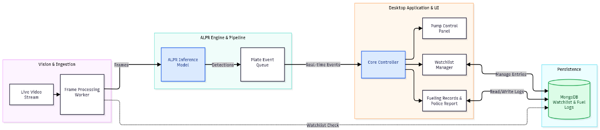

# Bowser Watch

Bowser Watch is a Python desktop application for fuel-station monitoring and drive-off prevention. It combines a PyQt6 interface, license-plate detection and OCR, a background video-processing worker, and MongoDB-backed watchlist and fueling records.

### Acrhitecture
<div align="center">
  
 </div>

## Source Code

The application source is included in this repository. The active application is the root-level `entry.py` and the modules alongside it. `bowser-watch/` is a separate, older copy with its own UI and worker; its requirements file is not the dependency manifest for the root application.

```text
CV2/
├── entry.py                         # Application entry point and main window
├── config.py                        # Loads application and database settings
├── config.toml                      # Local app, model, and database configuration
├── process.py                       # Background ALPR/video-processing worker
├── ui/
│   ├── pumpcontrollpanel.py          # Pump status and alert dashboard
│   ├── sidemenu.py                   # Navigation sidebar
│   ├── watchlist.py                  # Watchlist view
│   ├── fuelingrecord.py              # Fueling records and actions
│   ├── reportpolice.py               # Incident report dialog
│   ├── videoplayer.py                # Video playback UI
│   ├── style.qss                     # Qt stylesheet
│   └── uicomponent/fuelcard.py       # Fuel card UI component
├── watcher/
│   ├── inference/alpr.py             # ALPR model setup and plate normalization
│   ├── models/plateinfo.py           # Plate detection data model
│   ├── utils/db.py                   # MongoDB operations
│   ├── utils/platequeue.py           # Recent detection queue
│   ├── data/                         # Sample input videos
│   └── output/                       # Saved detection images
├── audio/alert.wav                   # Alert sound asset
└── bowser-watch/                     # Older, separate project copy
```

## Requirements

### Software

- Python 3.11 or newer (`config.py` uses the standard-library `tomllib` module)
- pip and a virtual environment
- MongoDB deployment accessible from the machine (local or Atlas)
- A graphical desktop session for PyQt6
- Network access for MongoDB and, where needed, first-time ALPR model downloads

### Python packages

The root application imports `PyQt6`, `pymongo`, `certifi`, `cv2` (provided by `opencv-python`), and `fast-alpr`. Install them into the active Python environment:

```bash
python -m pip install --upgrade pip
python -m pip install PyQt6 pymongo certifi opencv-python fast-alpr
```

There is currently no root-level `requirements.txt`; `bowser-watch/requirements.txt` belongs to the older nested copy and does not list every package required by the root application.

## Installation

From the repository root, create and activate a virtual environment.

Linux/macOS:

```bash
python3 -m venv .venv
source .venv/bin/activate
python -m pip install --upgrade pip
python -m pip install PyQt6 pymongo certifi opencv-python fast-alpr
```

Windows PowerShell:

```powershell
py -3.11 -m venv .venv
.venv\Scripts\Activate.ps1
python -m pip install --upgrade pip
python -m pip install PyQt6 pymongo certifi opencv-python fast-alpr
```

## Configuration

The application loads `config.toml` from the current working directory. It contains the app name/debug setting, ALPR detector and OCR model names, detector confidence, and MongoDB database and collection names. Keep this file present when running the app.

Set `MONGO_URI` and `MONGO_DB_NAME` in the environment to override the MongoDB connection string and database name. Configure a MongoDB user with access to the selected database and ensure network access is allowed by the MongoDB server or Atlas network rules. Do not commit credentials or share a configuration file containing secrets. The connection is validated when the application starts.

The worker reads `watcher/data/test1.mp4`, saves qualifying plate images under `watcher/output/`, and loads the UI stylesheet from `ui/style.qss`. Launch from the repository root so these relative paths resolve.

## Build and Run

There is no separate compile or packaging step currently defined; run the Python source directly. With the virtual environment active and MongoDB configured, execute from the repository root:

```bash
python entry.py
```

The main window opens with pump monitoring, watchlist, and fueling-record views. The worker processes the sample video in the background and sends detection and watchlist-alert updates to the interface. Close the window normally to close the MongoDB connection.

For a headless Linux session, a display server or virtual display is needed by Qt. For example, where Xvfb is installed:

```bash
xvfb-run -a python entry.py
```

## Architecture

- `entry.py` constructs the main window, connects UI signals, creates the MongoDB manager, and starts the worker thread.
- `ui/` contains the dashboard, navigation, watchlist, fueling records, report dialog, playback component, and stylesheet.
- `process.py` runs as a Qt worker thread. It samples video frames, calls the ALPR engine, selects a plate detection, stores an image when appropriate, checks the watchlist, and emits UI signals.
- `watcher/inference/alpr.py` configures `fast-alpr` from the model settings and normalizes recognized plate text.
- `watcher/utils/db.py` provides MongoDB access for watchlist and fueling data.
- `watcher/models/` and `watcher/utils/platequeue.py` hold detection data and recent plate events.
- `config.py` and `config.toml` supply runtime settings; sample videos and the alert audio are stored in `watcher/data/` and `audio/`.

## License
[MIT License](LICENSE)

